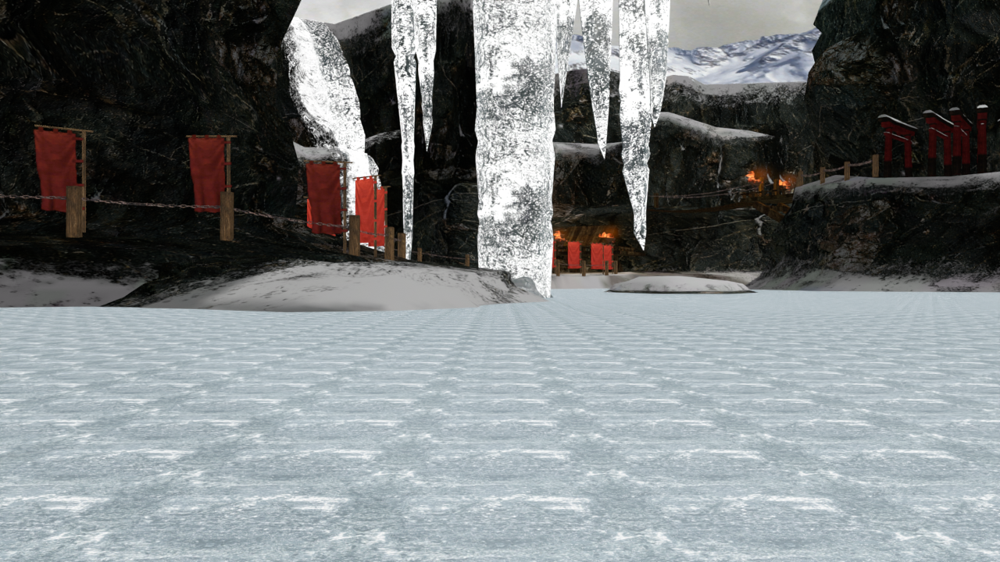
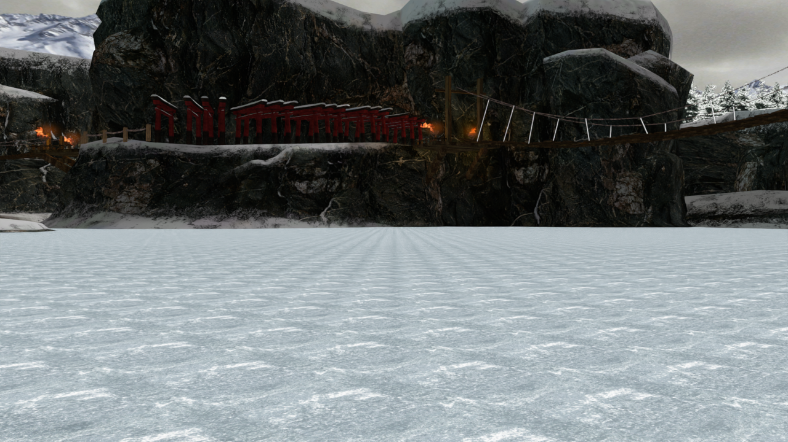
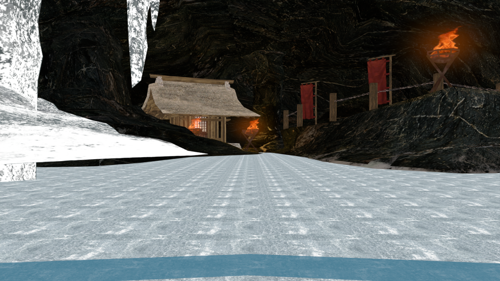
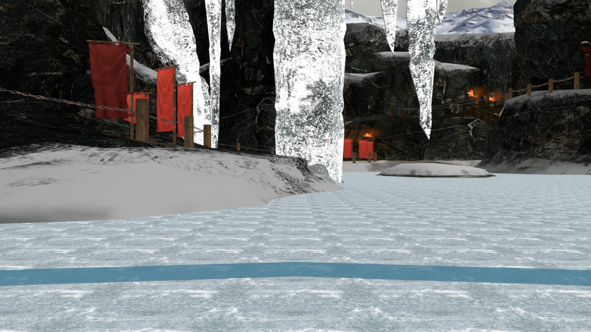
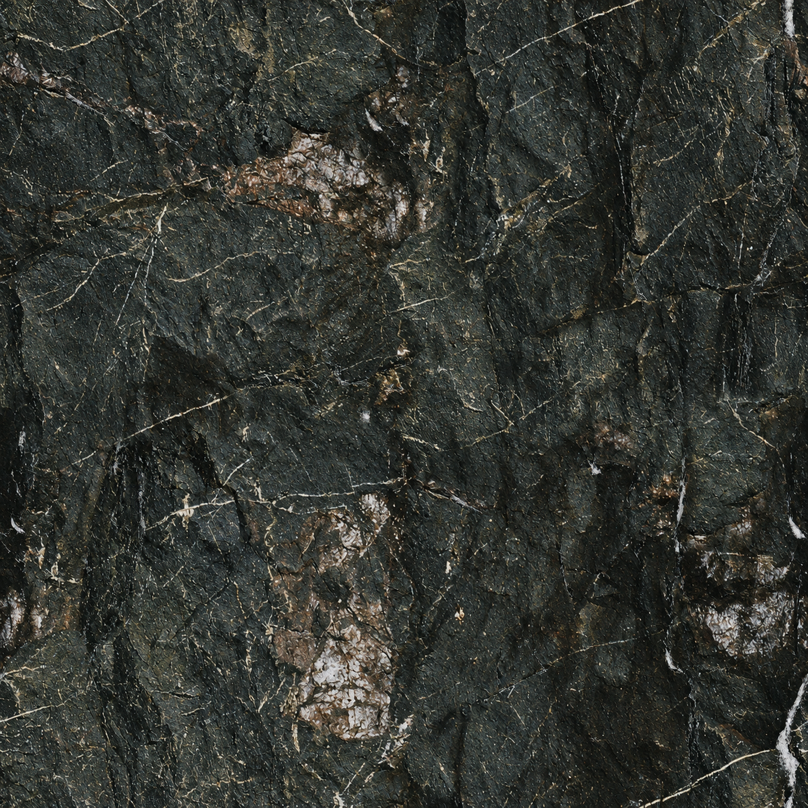
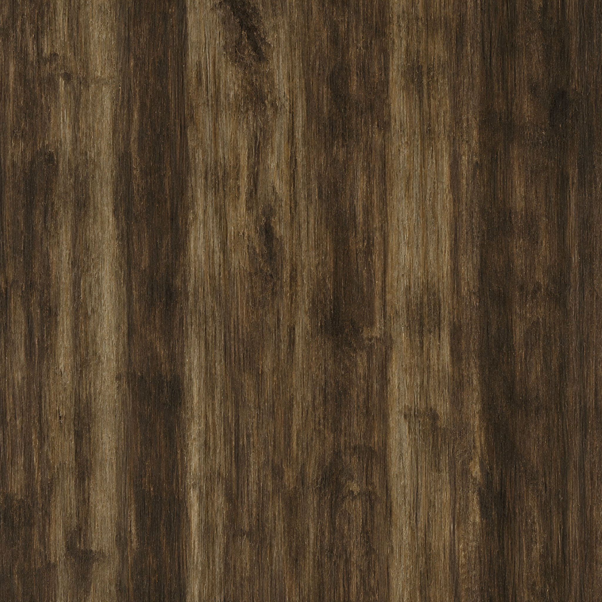

# Manji Valley для TEKKEN 8

Фанатский перенос окружения **Manji Valley из TEKKEN 6** в Steam-версию **TEKKEN 8**, заменяющий **Coliseum of Fate / ST04**.

**v0.1.0 — сохранённая установленная сборка от 10 ноября 2026.** Это версия с ледяным полом и падающим снегом. Интерактивный снег со следами и выемками **ещё не входит в эту версию**.



## Скачать

[**Скачать Manji Valley v0.1.0 — ZIP**](https://github.com/FedorPorshen/tekken8-manji-valley/raw/refs/heads/main/downloads/Manji-Valley-Native-Colosseum-v0.1.0.zip)

Архив содержит шесть готовых файлов мода. WinRAR подходит для распаковки. Blender, Unreal Editor, FModel, эмулятор и UE4SS для установки этой версии не нужны.

Контрольная сумма архива: [SHA256SUMS.txt](downloads/SHA256SUMS.txt). Отдельные файлы: [installed-build-files.json](downloads/installed-build-files.json). Содержимое архива сверено с установленной сборкой по SHA256.

## Как установить

1. Полностью закройте TEKKEN 8.
2. В Steam: **Библиотека → TEKKEN 8 → Управление → Просмотреть локальные файлы**.
3. Откройте `Polaris/Content/Paks/Mods`. Если папки `Mods` нет, создайте её.
4. Распакуйте ZIP и скопируйте **все шесть файлов** непосредственно в `Mods`:

```text
TEKKEN 8/
└── Polaris/Content/Paks/Mods/
    ├── ManjiValleyColosseum_P.pak
    ├── ManjiValleyColosseum_P.ucas
    ├── ManjiValleyColosseum_P.utoc
    ├── ManjiValleySnowFloor_P.pak
    ├── ManjiValleySnowFloor_P.ucas
    └── ManjiValleySnowFloor_P.utoc
```

5. Запустите игру и выберите **Coliseum of Fate**. Превью и название в выборе арен остаются оригинальными.

При обновлении замените предыдущие шесть файлов Manji Valley. Другие моды, заменяющие ST04, могут конфликтовать с этой картой. Оригинальные файлы игры в корне `Paks` заменять не требуется.

## Что изменено

- Восстановлена исходная сцена Manji Valley: скалы, ледяные образования, алтарь, дороги, знамена, японские ворота, мосты и жаровни.
- Окружение адаптировано к конечной боевой зоне TEKKEN 8. В TEKKEN 6 арена бесконечная; здесь сохранены игровые границы и коллизия Coliseum.
- В ряду оставлено 16 японских ворот вместо 21, увеличены промежутки.
- Пол покрыт льдом; снегопад распределён с учётом укрытий.
- У границы появляется узкая голубая полоса с низким ободком. Издалека подсказка скрывается.
- Исправлены мост и канаты, чёрные квадраты вокруг огня и белая плоскость поверх льда.
- Основной камень и дерево получили варианты с повышенной детализацией. Исходные карты освещения сохранены.
- Толпа Coliseum отключена. Зимняя атмосфера пока временная: оригинальный звук арены TEKKEN 6 ещё не перенесён.

## Статус и ограничения

- Сборка предназначена для **TEKKEN 8 3.02.02**. Совместимость с другими версиями отдельно не подтверждена.
- Это незавершённый перенос. Возможны отличия масштаба, материалов и освещения от TEKKEN 6.
- Снегопад уже есть; деформация снега от шагов, падений и сброса тренировки находится в разработке.
- Сборка прошла Unreal Cook без ошибок, контейнеры и установленная копия проверены. Представленные ниже изображения получены в Blender; они не являются доказательством идентичного отображения всех эффектов в TEKKEN 8.
- Размытость всей картинки также зависит от разрешения рендера, апскейлинга и настроек текстур игры.

## Рендеры Blender

Это проверочные рендеры экспортируемой геометрии. Бойцы и интерфейс TEKKEN 8 в них отсутствуют. Материалы погоды, огня и границы в игре могут выглядеть иначе.







## Текстуры

Два варианта основного камня и дерева подготовлены с помощью встроенного imagegen на основе исходных изображений. Выход генератора 1254 × 1254 приведён к 2048 × 2048 для импорта и mip-уровней; увеличение размера само по себе не считается восстановлением исходных деталей. Остальные текстуры не объявляются HD.

| Камень | Дерево |
| --- | --- |
|  |  |

[Запросы генерации](docs/textures/generation-prompts.json).

## Как удалить

Закройте игру и удалите только перечисленные выше шесть файлов из `Polaris/Content/Paks/Mods`. После запуска Coliseum снова будет использовать штатное окружение.

## Авторы и ресурсы

Проект: **FedorPorshen**. Подготовка переноса и инструментов выполнялась при помощи Codex. Оригинальная арена и игровые материалы TEKKEN принадлежат их правообладателям; это неофициальный фанатский мод, не связанный с Bandai Namco.

В работе использовались Blender, Unreal Engine 5.2, FModel, retoc и repak. ISO, полная игра, редактор Unreal, сторонние утилиты и ключи игры в репозиторий не включены.

---

**English:** Manji Valley from TEKKEN 6, adapted as a Coliseum of Fate replacement for TEKKEN 8 (Steam, target version 3.02.02). Close the game and extract all six mod files into `Polaris/Content/Paks/Mods`, then select Coliseum of Fate. Stage preview/name remain unchanged. This snapshot includes ice and falling snow; interactive snow deformation is still in development. The gallery contains Blender renders, not in-game screenshots.
