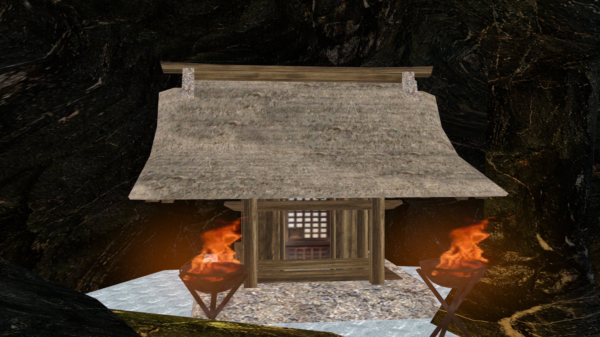
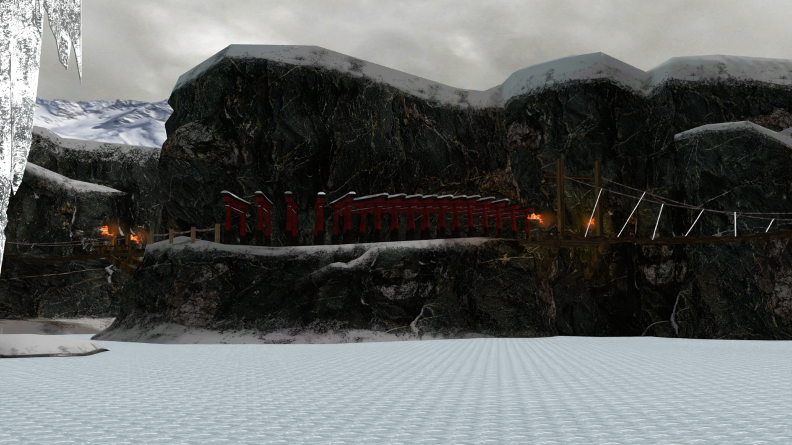
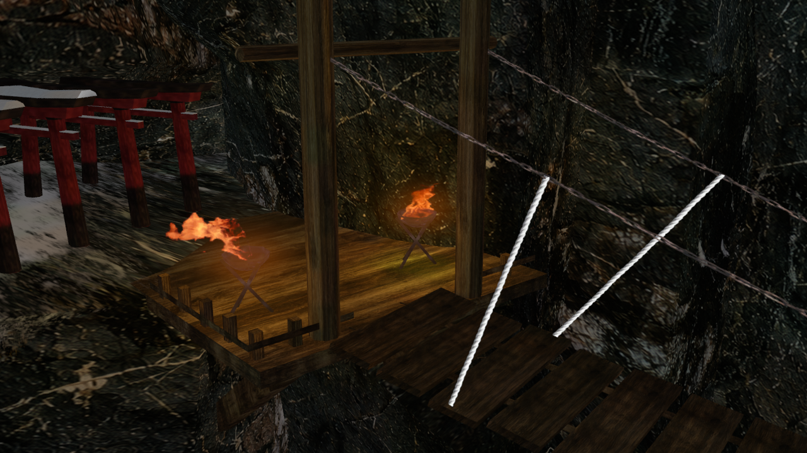
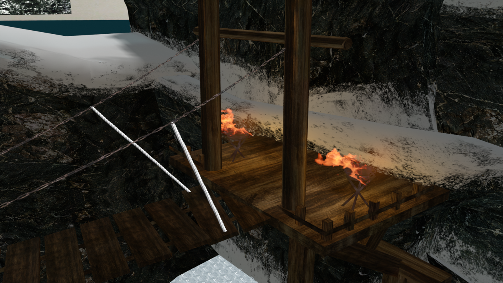
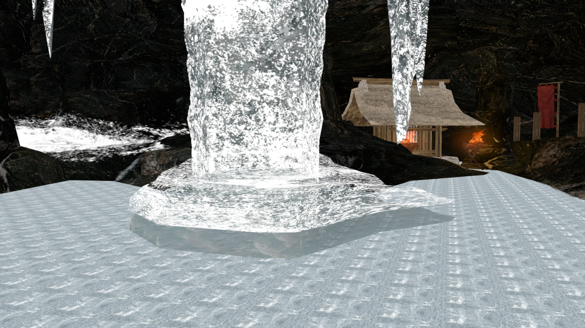

# Manji Valley для TEKKEN 8

Фанатский перенос **Manji Valley из TEKKEN 6** в Steam-версию **TEKKEN 8**. Мод заменяет окружение **Coliseum of Fate / ST04**, сохраняя конечную боевую зону и игровую коллизию этой арены.

**Текущий снимок: v0.2.0-preview.1, 10 ноября 2026. Целевая версия игры: 3.02.02.**

Это незавершённая сборка для проверки. Окружение и падающий снег уже демонстрировались в игре; последние исправления, новая граница и интерактивный снежный слой ещё ожидают проверки пользователем. **Работа следов и выброса снега при падении в игре не подтверждена.**



## Скачать

| Архив | Содержимое |
| --- | --- |
| [Карта v0.2.0-preview.1](downloads/Manji-Valley-Native-Colosseum-v0.2.0-preview.1.zip) | 6 файлов окружения, погоды, льда и экспериментального снежного слоя |
| [Название и превью](downloads/Manji-Valley-UI-v0.2.0-preview.1.zip) | MANJI VALLEY, изображения святилища и 2 ролика выбора арены |
| [Обработчик снега — экспериментальный](downloads/Manji-Valley-Snow-Runtime-v0.2.0-preview.1.zip) | 3 Lua-скрипта; необходим уже установленный совместимый UE4SS |

Нужен готовый архив из таблицы, а не кнопка GitHub **Code → Download ZIP**. Для распаковки подходит WinRAR. Blender, Unreal Editor, FModel и эмулятор для установки готовой карты не нужны.

[SHA256 архивов](downloads/SHA256SUMS.txt) · [Состав текущего установленного снимка](downloads/current-build-files.json) · [Изменения](CHANGELOG.md).

Предыдущая v0.1.0 сохранена отдельно: [старая сборка](downloads/Manji-Valley-Native-Colosseum-v0.1.0.zip). Не смешивайте её файлы с текущей версией.

## Установка карты

1. Полностью закройте TEKKEN 8.
2. В Steam откройте **Библиотека → TEKKEN 8 → Управление → Просмотреть локальные файлы**.
3. Сохраните копии прежних файлов Manji Valley, если мод уже установлен.
4. Распакуйте архив карты. Все шесть файлов скопируйте в `Polaris/Content/Paks/Mods` внутри папки игры:

```text
Polaris/Content/Paks/Mods/
├── ManjiValleyColosseum_P.pak
├── ManjiValleyColosseum_P.ucas
├── ManjiValleyColosseum_P.utoc
├── ManjiValleySnowFloor_P.pak
├── ManjiValleySnowFloor_P.ucas
└── ManjiValleySnowFloor_P.utoc
```

Если `Mods` отсутствует, создайте её. Заменяйте весь комплект, а не отдельный `.pak`. Другие моды, заменяющие ST04, могут конфликтовать с этой картой. Штатные контейнеры в корне `Paks` менять не требуется.

## Название, картинки и загрузка

1. Распакуйте архив интерфейса.
2. Три файла `ManjiValleyUI_P.pak/.ucas/.utoc` из него скопируйте в `Polaris/Content/Paks/Mods`.
3. **Сначала сохраните копии двух существующих роликов** в `Polaris/Content/Movies/usm/StageSelect`, затем замените их одноимёнными файлами из архива:

```text
Mov_UI_SS_Stage_04_Colosseum.usm
Mov_UI_SS_Stage_Decide_04_Colosseum.usm
```

Превью показывает святилище с жаровнями крупным планом. Обновлены текстура названия, миниатюры, фон перед боем, изображения Jukebox и повторов, а также два ролика выбора. Арена занимает прежнюю ячейку Coliseum of Fate; внутренний идентификатор ST04 сохранён. Замена текстового имени во всех возможных меню не подтверждена.

После установки запустите игру обычным способом через Steam и выберите эту ячейку арены.

## Что со снегом

**Похожую механику воссоздать технически возможно. Готовый аналог снега TEKKEN 6 в этом проекте пока не получен.** Нативный код снега TEKKEN 6 не перенесён: используется новая реализация поверх льда.

| Часть | Текущий статус |
| --- | --- |
| Падающие снежинки | Присутствуют в игре; распределение учитывает небольшое укрытие у святилища |
| Снежный слой над льдом | Включён в текущую карту и сделан видимым при загрузке; отображение этой ревизии ожидает проверки |
| Выемки и следы при движении | Код и материалы подготовлены, но работа с реальными бойцами не подтверждена |
| Выброс снега при падении | Подготовлен пул эффектов, игровая интеграция не подтверждена |
| Очистка следов при сбросе тренировки | Реализована в коде, проверена с имитацией API; ожидает игровой проверки |

Обработчик рассчитан **только на тренировку на Manji Valley**. Для контактов используется маска 2048 × 2048, меняющая высоту и видимость снежного слоя. При недоступности костей стоп предусмотрен упрощённый контакт под бойцом; он не равен точным следам обеих ног. Совпадение с оригиналом один в один и производительность пока не подтверждены.

В предыдущем запуске журнал показал остановку на поиске PlayerController, поэтому интерактивный слой не активировался. В этой ревизии зависимость от PlayerController убрана: используются объекты самой сцены. **Исправление причины в коде не считается подтверждением работы снега в игре.**

### Установка экспериментального обработчика

1. Установите карту текущей версии и используйте совместимый с вашей игрой UE4SS. Сам загрузчик UE4SS, его DLL и настройки **не входят** в архив проекта.
2. Скопируйте папку `ManjiValleySnow` из архива обработчика в папку `Mods` вашей установки UE4SS. В используемой при разработке установке путь выглядит так:

```text
Polaris/Binaries/Win64/Mods/ManjiValleySnow/Scripts/
├── main.lua
├── render_bridge.lua
└── snow_state.lua
```

3. В существующем `Mods/mods.txt` включите строку `ManjiValleySnow : 1`. Не заменяйте список остальных модов.
4. Проверяйте механику в тренировке на нужной арене. Горячая клавиша F9 не требуется.

Без работающего обработчика следы, выброс снега и реакция границы на координаты бойцов не гарантируются. Падающие снежинки и само окружение относятся к пакету карты. Порядок подключения Lua-модов описан в [документации UE4SS](https://docs.ue4ss.com/dev/guides/creating-a-lua-mod).

Техническая основа подхода — [рисование материала в Render Target](https://dev.epicgames.com/documentation/en-us/unreal-engine/blueprint-and-render-targets-reference?application_version=4.27) и [вызовы в игровом потоке через UE4SS](https://docs.ue4ss.com/dev/lua-api/global-functions/executeingamethread.html). Эти возможности поддерживают выбранный подход, но сами по себе не доказывают совместимость конкретной реализации с TEKKEN 8.

## Окружение и последние изменения

- Используется геометрия и взаимное расположение объектов из извлечённой сцены TEKKEN 6 с адаптацией к конечной арене TEKKEN 8.
- В ряду оставлено 16 ворот вместо 21. В последней ревизии их центры распределены с одинаковым шагом вдоль исходной дороги; в перспективе расстояния в кадре могут отличаться.
- Концы тросов моста привязаны к четырём деревянным опорам; настил соединён с площадками.
- У ледяной колонны удалена лишняя белая накладка, а текстурированное основание опущено к поверхности озера.
- Исходные формы каменных объектов сохранены. Для основного камня изменён вертикальный повтор текстуры, чтобы уменьшить заметный шов; результат в игре ожидает проверки.
- Вместо низкого ободка добавлена полупрозрачная граница высотой около 1,9 м. Она должна плавно проявляться при приближении; игровая коллизия Coliseum сохранена.
- Основной камень и дерево используют подготовленные варианты текстур 2048 × 2048; исходные карты освещения сохранены.
- Толпа Coliseum отключена. Зимний фон временный: оригинальная звуковая атмосфера TEKKEN 6 ещё не перенесена.

## Проверки и ограничения

Проверены без запуска игры: Unreal Cook без ошибок, целостность контейнеров, совпадение установленных файлов по SHA256, обратное извлечение шести UI-текстур, полное декодирование роликов на 450 и 35 кадров, геометрические привязки мостов и шаг ворот. Логика Lua проверена с имитацией игрового API.

**Имитационный тест Lua и его строка `GPU mask probe` не являются проверкой GPU или реального боя.** Последняя сборка не объявляется визуально принятой, а снег — завершённым.

Сохраняются отличия материалов, света и масштабов от TEKKEN 6. Совместимость с другими патчами игры, всеми режимами и модами отдельно не подтверждена. Рендеры ниже не показывают работу интерактивного снега в TEKKEN 8.

## Рендеры и материалы

Это **рендеры Blender**, а не игровые скриншоты. Материалы погоды, огня, границы и снега в игре могут выглядеть иначе.









| Камень | Дерево |
| --- | --- |
|  |  |

Эти два варианта подготовлены через imagegen по исходным текстурам. Результаты 1254 × 1254 приведены к 2048 × 2048 для импорта; увеличение размера само по себе не восстанавливает утраченные детали. Остальные материалы не объявляются HD. [Запросы генерации](docs/textures/generation-prompts.json).

## Файлы проекта

- `downloads/` — готовые пакеты, контрольные суммы и состав установленного снимка.
- `source/blender/Manji-Valley-current.blend` — текущая сцена для осмотра и рендера, с упакованными текстурами. Это не готовый проект Unreal.
- `source/snow/` — актуальные три Lua-скрипта, совпадающие с архивом обработчика.
- `source/tools/` — вспомогательные скрипты построения и проверки снежных ресурсов, описанные в [заметках для разработки](docs/DEVELOPMENT.md).
- `docs/renders/`, `docs/textures/` — иллюстрации и примеры материалов.

Полная установка Unreal Engine, исходные ISO/архивы игры, ключи, пользовательские настройки и журналы в репозиторий не входят. Вспомогательные скрипты не являются автономной пересборкой всего мода из чистого клона.

## Удаление и откат

Закройте игру. Для удаления карты уберите только шесть файлов Manji Valley из списка установки. Для удаления интерфейса уберите три файла `ManjiValleyUI_P` и верните сохранённые исходные `.usm`. Для отключения обработчика снега поставьте `ManjiValleySnow : 0` в списке UE4SS. Остальные моды не удаляйте.

Для отката используйте полный сохранённый комплект одной ревизии. Старый архив v0.1.0 содержит только карту: новые UI-файлы и обработчик отключаются отдельно.

## Как идёт работа

Пользователь сам запускает игру и присылает замечания. Исполнитель исправляет проект и проверяет файлы/сборку, **не запускает игру самостоятельно**. Неподтверждённые возможности явно отмечаются. Коммит и push этого репозитория выполняет пользователь.

## Авторы

Проект: **FedorPorshen**, подготовка при помощи Codex. TEKKEN и оригинальные игровые материалы принадлежат их правообладателям. Это неофициальный фанатский мод, не связанный с Bandai Namco.

В работе использовались Blender, Unreal Engine 5.2, FModel, retoc, repak и UE4SS. Их исполняемые файлы не включены.

**English:** Work-in-progress Manji Valley environment from TEKKEN 6, replacing Coliseum of Fate / ST04 in TEKKEN 8 (Steam, target 3.02.02). Install the six stage files in `Polaris/Content/Paks/Mods`. The separate UI package replaces preview images and two stage-select movies; back up the original movies first. Interactive snow is experimental, requires compatible UE4SS and is limited to Practice mode. Footprints and impact effects have **not** been verified in the running game. The gallery contains Blender renders.
