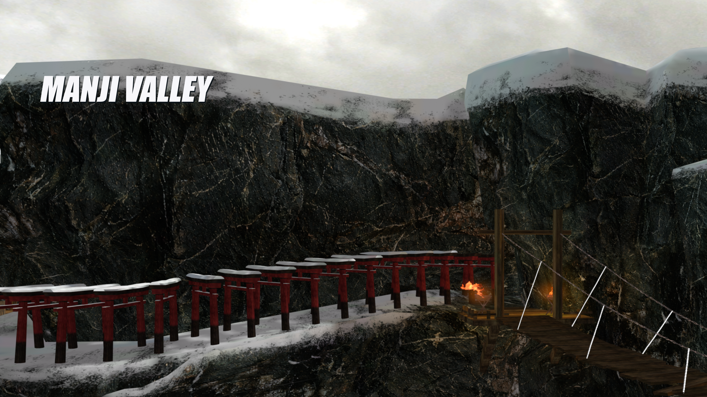

# Файлы Manji Valley

- [Сцена Blender](../source/blender/Manji-Valley-current.blend) содержит упакованные текстуры и камеру нового превью. Её можно открыть для осмотра и рендера.
- [Скрипт подсветки](../source/boundary/main.lua) совпадает с файлом в архиве. Он передаёт мировые координаты бойцов в материал трёхметровой границы через UE4SS.
- `source/snow/` и `source/tools/` относятся к эксперименту из v0.2.0-preview.1. Текущая сборка использует ледяной пол и отдельный скрипт подсветки.

Unreal Cook завершился без ошибок. Контейнеры, шесть текстур интерфейса и оба ролика проверены. Все 12 игровых файлов архива сверены по SHA-256 со сборкой. Работу новой подсветки в бою ещё предстоит проверить.

## Рендеры Blender

[Святилище](renders/shrine-side.png) · [Вид на долину](renders/valley-and-shrine.png) · [Крепление тросов моста](renders/gate-rope-full.png)

## Материалы

[Камень](textures/rock-restored.png) · [Дерево](textures/wood-restored.png)

Эти варианты текстур подготовлены на основе игровых материалов с помощью генерации изображений. Для импорта их размер увеличен до 2048 × 2048. [Запросы генерации](textures/generation-prompts.json)
